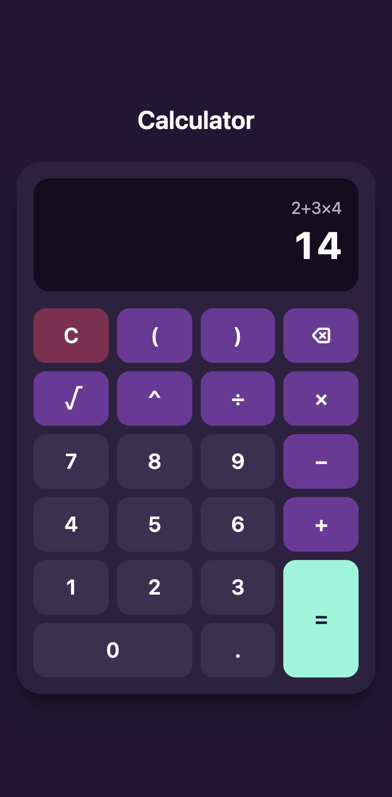

# Sezzle Calculator

A calculator with a React + TypeScript frontend and a Go REST API. Supports
full expressions with operator precedence (`2 + 3 × 4 = 14`), parentheses,
exponents and square roots, evaluated by a hand-written recursive descent parser.

<p align="center">
  
  
</p>

## Contents

- [Tech stack](#tech-stack)
- [Quick start (Docker)](#quick-start-docker)
- [Running locally](#running-locally)
- [API](#api): [endpoints](#api), [examples](#examples), [errors](#errors), [manual test session](#full-manual-test-session)
- [Tests and coverage](#tests-and-coverage)
- [Design decisions](#design-decisions)
- [Assumptions](#assumptions)
- [Known limitations and future work](#known-limitations-and-future-work)
- [AI usage](#ai-usage)

## Tech stack

| Layer    | Tech |
|----------|------|
| Backend  | Go 1.27 (standard library only: `net/http`, `encoding/json`) |
| Frontend | React 19, TypeScript, Vite, Tailwind CSS v4 |
| Testing  | `go test`, Vitest, React Testing Library |
| Deploy   | Docker multi-stage builds, nginx reverse proxy, Docker Compose |

## Quick start (Docker)

```bash
docker compose up --build
```

Open http://localhost:3000. Only the frontend (nginx) is published to the host;
it serves the UI and proxies `/api/` to the backend, which is reachable only
inside the Compose network.

## Running locally

**Requirements:** Go 1.27+, Node 24+, pnpm (`corepack enable`).

```bash
# Backend → http://localhost:8080
cd backend
go run ./cmd/server        # or: make run

# Frontend → http://localhost:5173 (proxies /api to :8080)
cd frontend
pnpm install
pnpm dev
```

Backend environment variables:

| Variable         | Default                 | Description                |
|------------------|-------------------------|----------------------------|
| `PORT`           | `8080`                  | Port the server listens on |
| `ALLOWED_ORIGIN` | `http://localhost:5173` | Origin allowed by CORS     |

## API

Base URL: `http://localhost:8080` (local) or `http://localhost:3000` (Docker,
via nginx; the backend port is not exposed). All endpoints accept and return
JSON. Requests must send `Content-Type: application/json`.

| Method | Endpoint              | Body                               | Example result    |
|--------|-----------------------|------------------------------------|-------------------|
| POST   | `/api/v1/evaluate`    | `{"expression": "2+3*4"}`          | `14`              |
| POST   | `/api/v1/add`         | `{"a": 5, "b": 3}`                 | `8`               |
| POST   | `/api/v1/subtract`    | `{"a": 5, "b": 3}`                 | `2`               |
| POST   | `/api/v1/multiply`    | `{"a": 5, "b": 3}`                 | `15`              |
| POST   | `/api/v1/divide`      | `{"a": 6, "b": 3}`                 | `2`               |
| POST   | `/api/v1/power`       | `{"a": 2, "b": 10}`                | `1024`            |
| POST   | `/api/v1/percentage`  | `{"a": 200, "b": 15}` (15% of 200) | `30`              |
| POST   | `/api/v1/sqrt`        | `{"a": 16}`                        | `4`               |
| GET    | `/health`             | —                                  | `{"status":"ok"}` |

Successful calculations respond with `{"result": <number>}`. Expressions
support `+ - * / ^`, parentheses, unary minus and `sqrt(...)`.

### Examples

Real responses from the running server:

```bash
curl -X POST localhost:8080/api/v1/evaluate \
  -H 'Content-Type: application/json' -d '{"expression":"(2+3)*4"}'
# 200 {"result":20}

curl -X POST localhost:8080/api/v1/divide \
  -H 'Content-Type: application/json' -d '{"a":5,"b":0}'
# 422 {"error":{"code":"DIVISION_BY_ZERO","message":"cannot divide by zero"}}

curl -X POST localhost:8080/api/v1/evaluate \
  -H 'Content-Type: application/json' -d '{"expression":"2+*3"}'
# 400 {"error":{"code":"INVALID_EXPRESSION","message":"invalid expression at position 2"}}
```

### Errors

| Status | Code | When |
|--------|------|------|
| 400 | `INVALID_JSON` | Malformed JSON, unknown field, trailing data |
| 400 | `MISSING_FIELD` | Required field absent or empty expression |
| 400 | `INVALID_EXPRESSION` | Syntax error (includes position) |
| 400 | `EXPRESSION_TOO_LONG` | Expression over 200 bytes |
| 413 | `BODY_TOO_LARGE` | Body over 4 KB |
| 415 | `UNSUPPORTED_MEDIA_TYPE` | Content-Type is not `application/json` |
| 422 | `DIVISION_BY_ZERO` | Division by zero |
| 422 | `NEGATIVE_SQRT` | Square root of a negative number |
| 422 | `INVALID_RESULT` | Overflow / non-finite result |
| 500 | `INTERNAL_ERROR` | Unexpected error (details logged, not exposed) |

Errors use the shape `{"error": {"code": "...", "message": "..."}}`.

**Rule:** 400 = the input is malformed; 422 = the input is valid but the math
is undefined.

### Full manual test session

<details>
<summary>Show the manual test session, with response headers</summary>

Run against the backend running locally on `localhost:8080`. Responses are trimmed to the status line, relevant headers and body; the `Access-Control-*` headers are identical on every response and `Date` varies.

#### Successful operations

```bash
curl -i -X POST localhost:8080/api/v1/add -H 'Content-Type: application/json' -d '{"a":5,"b":3}'
```

```
HTTP/1.1 200 OK
Access-Control-Allow-Headers: Content-Type
Access-Control-Allow-Methods: GET, POST, OPTIONS
Access-Control-Allow-Origin: http://localhost:5173
Content-Type: application/json
Content-Length: 13

{"result":8}
```

```bash
curl -i -X POST localhost:8080/api/v1/evaluate -H 'Content-Type: application/json' -d '{"expression":"2+3*4"}'
```

```
HTTP/1.1 200 OK
Content-Type: application/json

{"result":14}
```

```bash
curl -i -X POST localhost:8080/api/v1/add -H 'Content-Type: application/json' -d '{"a":5,"b":0}'
```

`b: 0` is a valid value (not treated as a missing field):

```
HTTP/1.1 200 OK
Content-Type: application/json

{"result":5}
```

```bash
curl -i localhost:8080/health
```

```
HTTP/1.1 200 OK
Content-Type: application/json

{"status":"ok"}
```

#### Error cases

Status code rule:

- **400**: the input is malformed (broken JSON, missing field, expression syntax, length).
- **422**: the input is well-formed but the math is undefined (division by zero, negative square root, overflow).
- **413**: the request body exceeds 4 KB.
- **415**: the `Content-Type` header is not `application/json`.

```bash
curl -i -X POST localhost:8080/api/v1/divide -H 'Content-Type: application/json' -d '{"a":5,"b":0}'
```

```
HTTP/1.1 422 Unprocessable Entity
Content-Type: application/json

{"error":{"code":"DIVISION_BY_ZERO","message":"cannot divide by zero"}}
```

```bash
curl -i -X POST localhost:8080/api/v1/add -H 'Content-Type: application/json' -d '{"a":5}'
```

```
HTTP/1.1 400 Bad Request
Content-Type: application/json

{"error":{"code":"MISSING_FIELD","message":"field \"b\" is required"}}
```

```bash
curl -i -X POST localhost:8080/api/v1/add -H 'Content-Type: application/json' -d '{"a":5,"b":3,"c":1}'
```

Unknown fields are rejected:

```
HTTP/1.1 400 Bad Request
Content-Type: application/json

{"error":{"code":"INVALID_JSON","message":"request body contains an unknown field"}}
```

```bash
curl -i -X POST localhost:8080/api/v1/add -H 'Content-Type: application/json' -d 'basura'
```

```
HTTP/1.1 400 Bad Request
Content-Type: application/json

{"error":{"code":"INVALID_JSON","message":"request body must be a single valid JSON object"}}
```

```bash
curl -i -X POST localhost:8080/api/v1/evaluate -H 'Content-Type: application/json' -d '{"expression":"2+*3"}'
```

```
HTTP/1.1 400 Bad Request
Content-Type: application/json

{"error":{"code":"INVALID_EXPRESSION","message":"invalid expression at position 2"}}
```

```bash
curl -i -X POST localhost:8080/api/v1/sqrt -H 'Content-Type: application/json' -d '{"a":-4}'
```

```
HTTP/1.1 422 Unprocessable Entity
Content-Type: application/json

{"error":{"code":"NEGATIVE_SQRT","message":"cannot calculate square root of negative number"}}
```

```bash
curl -i -X POST localhost:8080/api/v1/add -d '{"a":5,"b":3}'
```

Missing `Content-Type` header:

```
HTTP/1.1 415 Unsupported Media Type
Content-Type: application/json

{"error":{"code":"UNSUPPORTED_MEDIA_TYPE","message":"Content-Type must be application/json"}}
```

```bash
curl -i localhost:8080/api/v1/add
```

Wrong HTTP method:

```
HTTP/1.1 405 Method Not Allowed
Allow: POST
Content-Type: text/plain; charset=utf-8
X-Content-Type-Options: nosniff

Method Not Allowed
```

</details>

## Tests and coverage

```bash
# Backend
cd backend
go test ./internal/... -race -cover    # or: make test / make coverage

# Frontend
cd frontend
pnpm test        # watch mode
pnpm coverage    # single run + report in coverage/index.html
pnpm lint
```

| Package / area              | Coverage |
|-----------------------------|---------:|
| `internal/calculator`       | 93.0%    |
| `internal/api`              | 96.3%    |
| Backend total (`internal/`) | 94.4%    |
| Frontend (lines)            | 100%     |
| Frontend (branches)         | 86.1%    |

Full reports are committed in [`docs/coverage/`](docs/coverage):
[backend](docs/coverage/backend.txt) (per function) and
[frontend](docs/coverage/frontend.txt) (per file).

`cmd/server`, `main.tsx` and `App.tsx` contain only wiring and are excluded;
all their logic lives in tested packages. (`make test` runs `./...`, so it
also lists `cmd/server` at 0%.)

## Design decisions

- **Project structure:** pure logic lives in `internal/calculator` (no HTTP or
  JSON imports) and the HTTP layer in `internal/api`, so the math is testable
  in isolation and the transport can change without touching it. `cmd/server`
  only wires the pieces together.
- **Hand-written parser:** a tokenizer plus a recursive descent parser, with no
  `eval` and no libraries. Power is right-associative, so `2^3^2 = 512`, and
  `-2^2 = -4`, matching math convention. Syntax errors report the byte
  position. It reuses the calculator functions, so `10/0` behaves the same in
  every endpoint. Grammar, from lowest to highest precedence:

  ```text
  expression = term   { ("+" | "-") term }
  term       = unary  { ("*" | "/") unary }
  unary      = "-" unary | power
  power      = primary [ "^" unary ]
  primary    = number | "(" expression ")" | "sqrt" "(" expression ")"
  ```
- **Error handling:** domain errors are package-level vars checked with
  `errors.Is` and mapped to HTTP statuses in one place (`writeCalError`). The
  400/422 rule above makes the status code meaningful. Decode errors are
  replaced by fixed messages and unexpected errors are logged but never
  exposed, so no internals leak to clients.
- **Input hardening:** `http.MaxBytesReader` (4 KB), `DisallowUnknownFields`,
  exactly one JSON object per body, `Content-Type` enforcement, a 200-byte
  expression limit (which also bounds parser recursion), server timeouts
  (header 5 s, read 10 s, write 10 s, idle 60 s) and a panic-recovery
  middleware that returns a JSON 500.
- **Frontend architecture:** pure functions in `src/lib` (key rules,
  validation, formatting), a typed `fetch` client in `src/api`, one
  `useCalculator` hook holding the state, and thin components (`Display`,
  `Keypad`, `Calculator`). Logic sits in layers that can be tested without a
  browser, and the components only render.
- **Validation split:** the client does basic UX validation (empty expression,
  unbalanced parentheses) so obvious mistakes never hit the network. The
  backend is the source of truth and re-validates everything.
- **Same-origin setup:** the browser only talks to one origin. In development
  the Vite dev server proxies `/api` to `:8080`; in Docker nginx does the
  same, so CORS is not needed. The CORS middleware still exists for clients
  on another origin (default allowed origin `http://localhost:5173`).
- **Result formatting:** the backend returns the exact `float64`; the frontend
  trims float noise for display (`toPrecision(12)`, so `0.1 + 0.2` shows
  `0.3`). It is a presentation decision, not a change to the value.
- **Accessibility:** the result is a live region (`role="status"`, always
  mounted), errors use `role="alert"`, symbol keys have `aria-label`s, the
  keypad is a labelled group, there is full physical-keyboard support (digits,
  operators, Enter, Backspace, Escape) and a visible focus ring. Enter on a
  focused key activates that key instead of submitting.
- **Docker:** multi-stage builds; a static Go binary (`CGO_ENABLED=0`) running
  as a non-root user in the backend image; nginx as a same-origin reverse
  proxy for `/api/` and `/health` with the backend unpublished; a healthcheck that gates frontend start
  (`depends_on: service_healthy`); and `ENTRYPOINT` in exec form so the server
  receives `SIGTERM` and shuts down gracefully.

## Assumptions

- `percentage(a, b)` returns b% of a (`a` is the value, `b` the percentage).
- Numbers are IEEE-754 `float64`; results like `0.1 + 0.2` are rounded for
  display only.
- Expressions are ASCII only, with no implicit multiplication (`2(3)` is
  invalid) and no `%` inside expressions (ambiguous: modulo vs percent).
- Division by zero, square root of a negative and non-finite results are
  errors, not `Infinity` or `NaN`.

## Known limitations and future work

**Backend**

| Limitation | Why it is not fixed |
|---|---|
| No explicit recursion-depth limit in the parser | The 200-byte input cap already bounds depth to ~200 levels; a depth counter is the next improvement. |
| `len()` counts bytes, not characters | The tokenizer only accepts ASCII, where bytes = characters. The error message says "200 bytes" to be exact. |
| Router 404/405 responses are plain text | Go's mux generates them automatically; returning JSON requires a custom router or wrapping the mux. |
| CORS preflight answers on any path | Harmless for a stateless API without authentication. |
| `writeJSON` does not encode into a buffer first | The only payload is a finite `float64` (guaranteed by `finite()`), so encoding cannot fail. |
| `handleBinary` and `handleSqrt` duplicate decode/validate flow | They are two small handlers; a further abstraction would hurt readability. |
| No `slog` or dependency injection in the router | Out of scope here; it would be the first thing to add in a real service. |
| `ALLOWED_ORIGIN="*"` is not validated | Configuration is the deployer's responsibility; the expected value is documented above (a single origin such as `http://localhost:5173`). |

**Frontend**

| Limitation | Why it is not fixed |
|---|---|
| Disabled `=` key drops keyboard focus while loading | Low impact: the keyboard listener is on `window`, so Enter and typing keep working. Switching to `aria-disabled` would also change the "disabled while loading" test. |

**Deployment**

| Limitation | Why it is not fixed |
|---|---|
| Nginx resolves `backend` once at startup | If only the backend container is recreated, nginx may need a restart. |
| The frontend image keeps nginx's default user setup | Only the backend image is hardened to run as non-root. |

**Ideas:** arbitrary-precision decimals, calculation history, rate limiting,
structured logging with `slog`, an explicit parser depth counter.

## AI usage

See [PROMPTS.md](PROMPTS.md) for every prompt used, and what I accepted,
changed or rejected.
